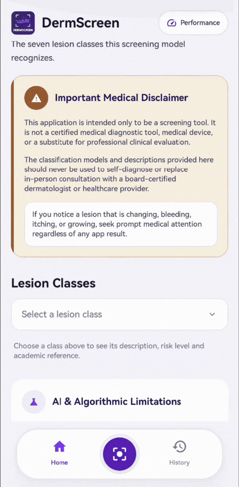

# DermScreen 

[](https://developer.android.com/)
[](https://kotlinlang.org/)
[](https://developer.android.com/jetpack/compose)
[](https://ai.google.dev/edge/litert)
[](LICENSE)

**DermScreen** is a fully offline, privacy-preserving Edge-AI mobile screening application designed for dermatological triage on resource-constrained consumer devices. Built natively for Android using Jetpack Compose and Google LiteRT (TensorFlow Lite), DermScreen executes FP16 quantized neural network inference completely on-device without cloud dependencies, guaranteeing zero network latency, immunity to erratic connectivity, and strict data sovereignty.

---

## 📌 Problem & Motivation

* **Specialist Scarcity:** Underserved and rural communities face severe shortages of specialized dermatologists, resulting in delayed diagnoses for critical skin conditions.
* **Connectivity Bottlenecks:** Cloud-dependent AI diagnostic systems fail in remote areas with poor or intermittent internet access.
* **Privacy Risks:** Disseminating unencrypted patient skin imagery to external cloud servers or public forums exposes sensitive Personal Health Information (PHI).
* **Hardware & Thermal Limits:** Full-precision AI models often exceed RAM budgets and trigger thermal throttling on low-tier consumer smartphones.

---

## 🎯 Key Objectives

1. **Edge Accessibility:** Provide instant, offline dermatological screening via an FP16 Quantized MobileNetV3 model optimized for low-tier hardware.
2. **Automated Vision-Gating:** Implement real-time mathematical image validation (blur detection, exposure checking, and skin coverage) with a **Hard Shutter Lock** to prevent low-quality inputs.
3. **Zero-Trust Privacy Vault:** Utilize AES-256-GCM envelope encryption and Android Keystore to lock SQLite data and image files securely on-device.
4. **Longitudinal Shift Analysis:** Enable comparative tracking over time to compute risk progression, confidence score deltas, and anatomical site consistency.

---

## ✨ Features & Capabilities

### 🔍 Real-Time Vision-Gating & CameraX Integration
* **Hard Shutter Lock:** The camera capture button remains locked until live image stream metrics meet critical clinical quality thresholds:
  * **Sharpness (Laplacian Variance):** Intercepts motion-blurred images.
  * **Luma / Exposure:** Rejects under-exposed or over-exposed scenes.
  * **Skin ROI Validation:** Ensures sufficient skin surface coverage before capture.

### 🧠 On-Device Edge-AI Inference Engine
* **FP16 Quantized Model:** Executes a MobileNetV3 architecture (`skin_lesion_fp16.tflite`) with Float16 (FP16) weight-only quantization using Google LiteRT (`com.google.ai.edge.litert`).
* **NNAPI Delegation Support:** Acceleration on supported device hardware while maintaining fallback capability for CPU execution.
* **Zero Network Dependency:** Operates 100% offline with zero external network calls.

### 🔒 Zero-Trust Cryptographic Storage & Biometric Auth
* **AES-256 Encrypted Database:** Built on Room and SQLCipher (`net.zetetic:sqlcipher-android`), encrypted with keys managed by the Android Keystore.
* **Secure Image Vault (`SecureImageVault`):** Raw lesion images are encrypted prior to writing to storage and decrypted on-demand into RAM for visual display, ensuring decrypted image bytes are never written to disk.

### 📊 Comparative Longitudinal Scan Analysis
* **Side-by-Side Morphological Comparison:** Compare a current scan against historical baseline records.
* **Risk Signal Progression:** Automated evaluation categorizes risk changes into `ESCALATED`, `IMPROVED`, or `UNCHANGED`.
* **Metric Delta Breakdown:** Displays side-by-side classification predictions, confidence percentages, body location verification (Macro/Micro regions), and contextual clinical takeaway guidance.

### 📄 Clinical PDF Report Generation
* **Encrypted Report Exporter:** Generates standardized, single-page clinical PDF summary reports on-device (`ClinicalPdfExporter`) for patient archiving or physician referral.

### 📈 Hardware Telemetry & Performance Diagnostic Monitor
* **Real-Time Memory Polling:** 1Hz Proportional Set Size (PSS) process memory tracking and per-inference memory delta ($\Delta\text{MB}$) monitoring.
* **Thermal Monitoring & Safety Cutoff:** Monitors device battery temperature and system thermal states, enforcing an auto-cutoff threshold ($45^\circ\text{C}$ trigger, $41^\circ\text{C}$ hysteresis recovery).
* **Automated AI Diagnostics Engine:** Executes 100-iteration stress benchmarks on-device with real-time sparkline latency visualization.
* **CSV Telemetry Export:** Exports performance history logs to CSV format for clinical auditing.

---

## 🔄 End-to-End Workflow Process

```
┌──────────────────────────────────────────────────────────────────────────────────┐
│                             1. VISION-GATING CAPTURE                            │
│  - Live CameraX Feed                                                             │
│  - Real-time Laplacian Variance (Blur), Luma (Lighting), Skin ROI Check         │
│  - Hard Shutter Lock releases when quality metrics pass                          │
└────────────────────────────────────────┬─────────────────────────────────────────┘
                                         │ Captures High-Quality Image
                                         ▼
┌──────────────────────────────────────────────────────────────────────────────────┐
│                            2. ON-DEVICE AI INFERENCE                             │
│  - Preprocess Image (224x224 RGB Tensor Normalization)                          │
│  - LiteRT FP16 Quantized MobileNetV3 Execution (`skin_lesion_fp16.tflite`)       │
│  - Logit Processing -> Class Probabilities & Risk Signal Mapping                 │
└────────────────────────────────────────┬─────────────────────────────────────────┘
                                         │ Inference Result
                                         ▼
┌──────────────────────────────────────────────────────────────────────────────────┐
│                       3. RESULTS & COMPARATIVE ANALYSIS                          │
│  - Display Diagnostic Prediction, Confidence %, Risk Level                       │
│  - Optional: Compare against saved baseline scan (Delta & Risk Progression)      │
│  - User selects Body Location (Macro / Micro Anatomical Regions)                 │
└────────────────────────────────────────┬─────────────────────────────────────────┘
                                         │ Save Selected
                                         ▼
┌──────────────────────────────────────────────────────────────────────────────────┐
│                         4. ZERO-TRUST ENCRYPTED VAULT                            │
│  - Raw image encrypted via AES-256-GCM -> SecureImageVault                       │
│  - Metadata saved to SQLCipher Encrypted Room Database                           │
└────────────────────────────────────────┬─────────────────────────────────────────┘
                                         │ Patient / Clinician Actions
                                         ▼
┌──────────────────────────────────────────────────────────────────────────────────┐
│                      5. CLINICAL EXPORT & TELEMETRY MONITOR                      │
│  - Export Patient Clinical PDF Report                                            │
│  - Monitor Hardware Performance & Export Telemetry CSV Logs                      │
└──────────────────────────────────────────────────────────────────────────────────┘
```

---

## 🏗️ Architecture & Technology Stack

DermScreen follows a **Three-Tier Edge Architecture** incorporating Clean Architecture principles:

```
├── presentation/               # Jetpack Compose UI & Navigation
│   ├── about/                  # Application overview & instructions
│   ├── history/                # Saved scan records, search, & comparison UI
│   ├── performance/            # Live telemetry, sparklines, & AI diagnostics
│   ├── visiongate/             # CameraX feed, real-time quality gating, & results
│   └── ui/theme/               # Color palette, typography, icons, & styling
├── domain/                     # Core Business Logic & Algorithms
│   ├── analyzer/               # TFLite loader, vision metrics, & parity runners
│   ├── comparison/             # Delta engine & risk progression evaluator
│   ├── export/                 # Clinical PDF generator
│   ├── guidance/               # Clinical triage rules & risk mappings
│   └── telemetry/              # Memory poller, thermal listener, & security key manager
└── data/                       # Data Persistence & Vault Storage
    ├── local/                  # Room DAO, ScanRecordEntity, & DermaDatabase
    └── local/SecureImageVault  # AES-256-GCM file encryption engine
```

### Core Technologies

| Layer | Technologies Used |
| :--- | :--- |
| **Language** | Kotlin 1.9+ |
| **UI Framework** | Jetpack Compose, Material 3, Navigation Compose |
| **Camera & Vision** | CameraX 1.4.2 (`camera-core`, `camera-camera2`, `camera-lifecycle`, `camera-view`) |
| **Edge AI Engine** | Google LiteRT 1.4.0 (`com.google.ai.edge.litert`) |
| **Database & Encryption** | Room 2.6.1, SQLCipher 4.9.0 (`net.zetetic:sqlcipher-android`), Android Keystore (`security-crypto:1.1.0-alpha06`) |
| **Biometrics** | AndroidX Biometric 1.2.0-alpha05 |
| **Asynchronous Engine** | Kotlin Coroutines, StateFlow, Flow |
| **Build & Tooling** | Gradle KTS, KSP (Kotlin Symbol Processing) |

---

## 🔬 Testing & Validation

The codebase includes comprehensive test suites covering model parity and comparative logic:

* **Comparison Logic Tests (`ComparisonLogicTest.kt`):** Validates risk escalation, improvement, stability calculations, time elapsed formatting, and anatomical site comparison logic.
* **Model Parity Tests (`ModelParityTest.kt`):** Ensures quantized FP16 model predictions match golden reference outputs within acceptable numerical tolerance.

To execute tests from command line:
```bash
./gradlew test
```

---

## 📄 License

This project is licensed under the MIT License - see the [LICENSE](LICENSE) file for details.
